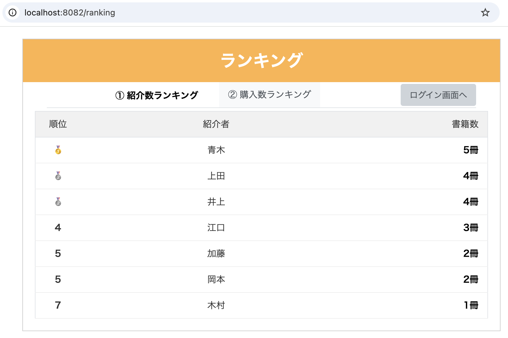
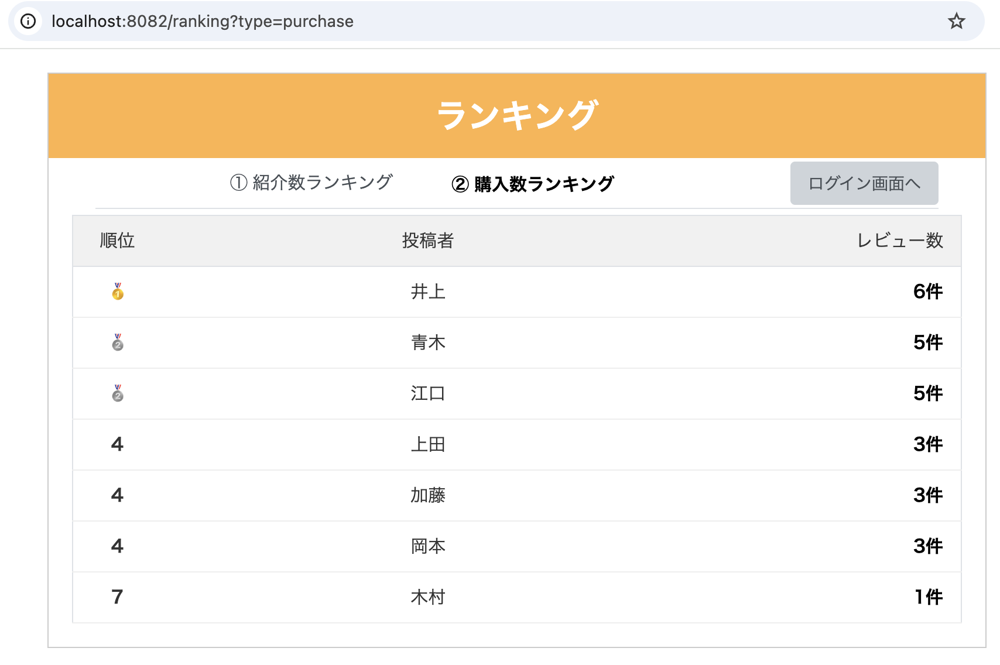
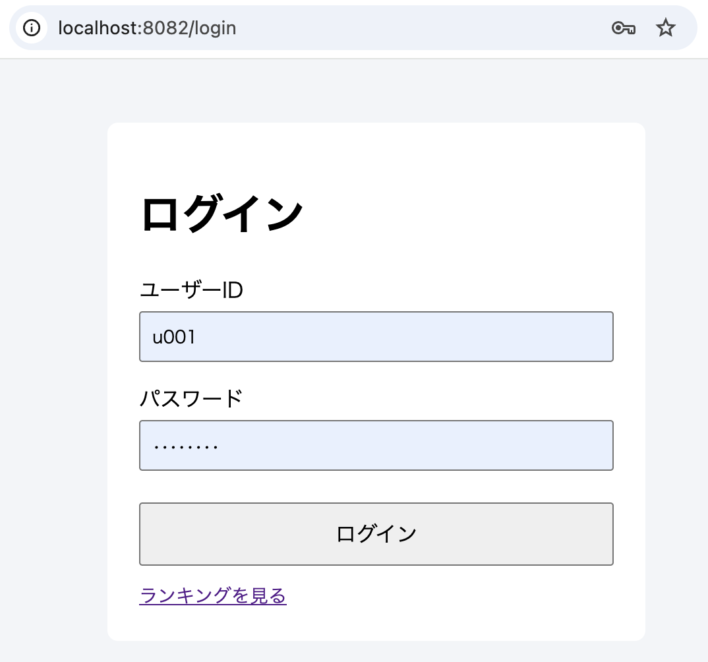
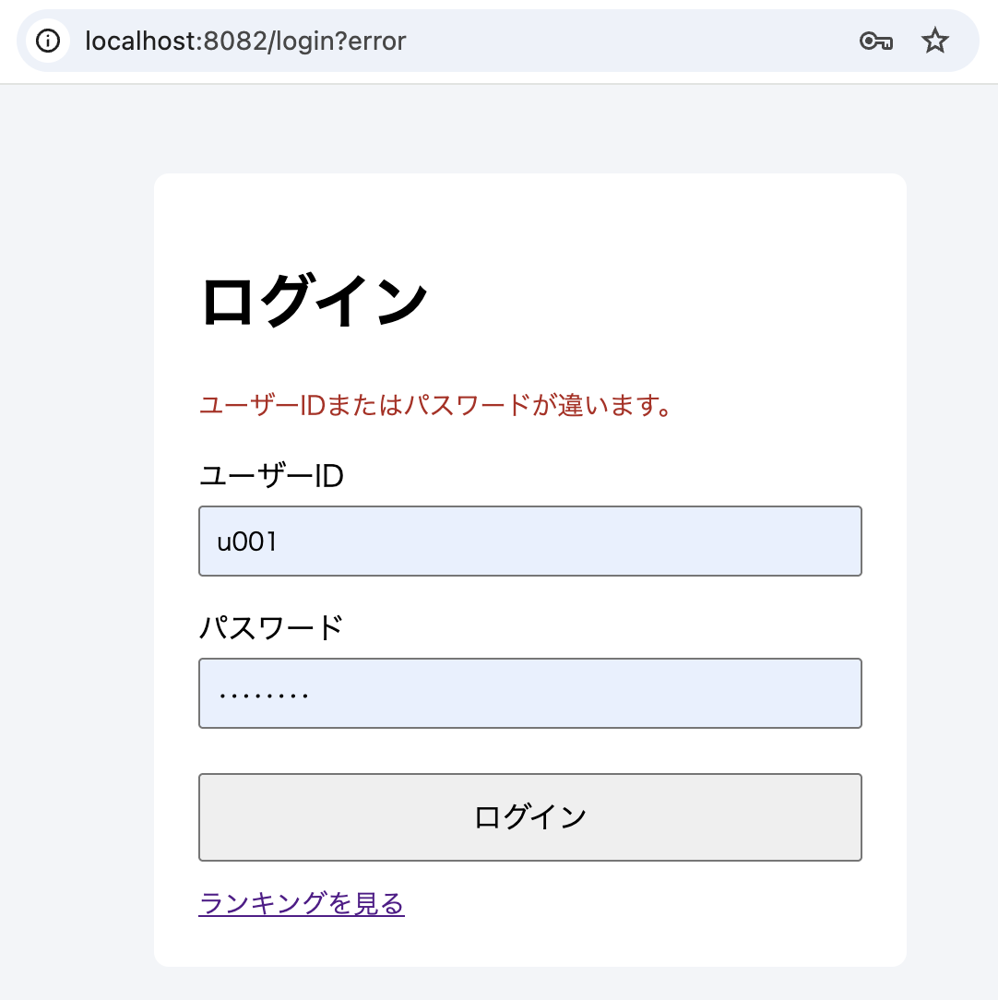
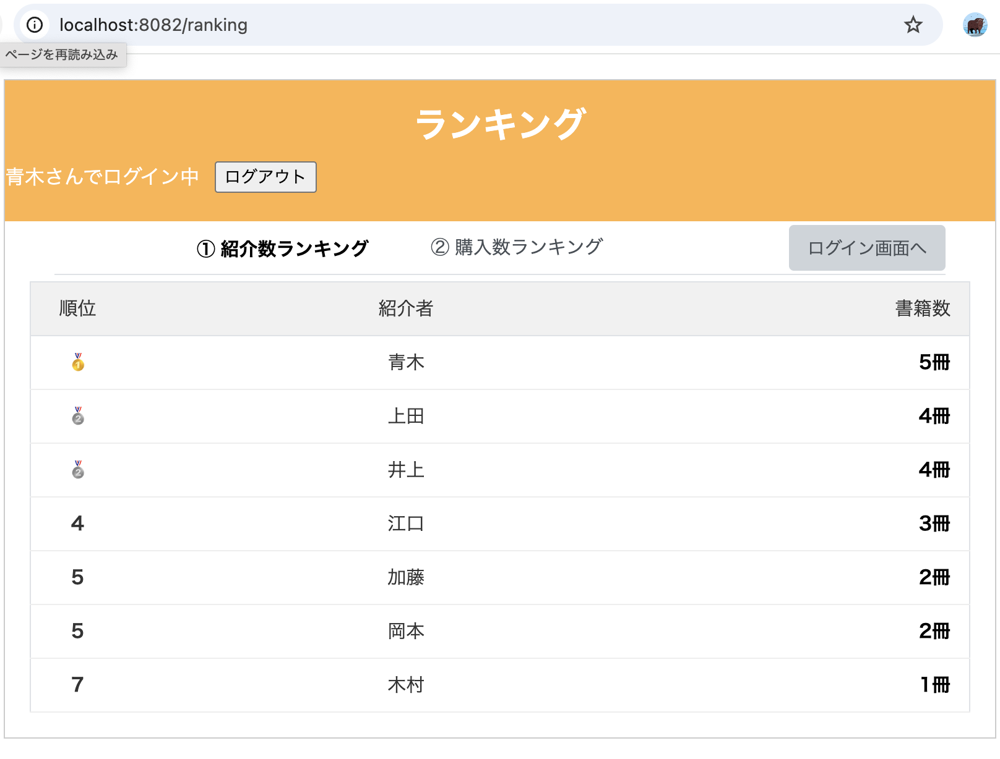
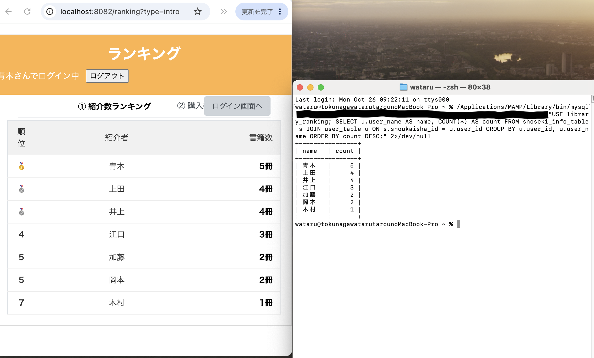

# 図書館掲示板（ランキング機能）

研修で制作した「図書館掲示板」（本を紹介し、レビューを書き合うWebアプリ）のうち、**自分が担当したランキング機能**を、単独で動く形に整理したポートフォリオです。ログイン機能は、この整理にあわせて**新しく書き直しました**。

表示している名前・書籍・レビューは、すべて架空のサンプルです。

## 公開サイト

- URL：（準備中）
- 初回は起動に1分ほどかかります（無料の公開環境のため、しばらくアクセスがないと停止します）。

## 機能

- **紹介数ランキング**：本を紹介した冊数が多い順
- **購入数ランキング**：紹介した本についたレビュー数が多い順（購入数＝レビュー数として集計）
- **同率順位**：同じ件数のユーザーは同じ順位（例：1位、2位、2位、4位）
- **メダル表示**：1〜3位はメダル、4位以降は数字
- **ログイン**：ユーザーIDとパスワードで認証（パスワードはBCryptで保存）

## 使用技術

Java 17 / Spring Boot 3.0.0 / MyBatis / Thymeleaf / Spring Security / MySQL 5.7 / Lombok

## 処理の流れ

    ブラウザ → Controller → UseCase → Repository → Datasource → Mapper(SQL) → MySQL

- SQL（Mapper）：ユーザーごとの件数を集計し、多い順に並べる
- UseCase：同率を考慮して順位を計算する
- 画面（Thymeleaf）：順位・名前・件数を表で表示する

MySQL 5.7 にはRANK()関数がないため、順位の計算はSQLではなくJavaで行っています。

## 自分が書いた範囲

- ランキング機能一式（SQL、DTO、UseCase、Repository、Datasource、Controller、画面、CSS）
- ログイン機能（Spring Security の設定、認証、ログイン画面）：このリポジトリのために新しく作成
- サンプルデータとテーブル定義（db/ フォルダ）

## ローカルでの起動方法

前提：Java 17、MySQL（ポート8889の例）。

1. データベースを作る

        mysql --default-character-set=utf8mb4 -uroot -p -h127.0.0.1 -P8889 < db/schema.sql
        mysql --default-character-set=utf8mb4 -uroot -p -h127.0.0.1 -P8889 < db/seed.sql

2. 環境変数にDBのパスワードを設定して、起動する

        export DB_PASSWORD=（MySQLのパスワード）
        ./mvnw spring-boot:run

3. ブラウザで開く

   - ランキング：http://localhost:8082/ranking
   - 購入数：http://localhost:8082/ranking?type=purchase
   - ログイン：http://localhost:8082/login

## サンプルのログイン情報

ユーザーID：`u001`〜`u007`　パスワード：`demo1234`（全員共通のサンプルです）

## 画面

### 紹介数ランキング

### 購入数ランキング

### ログイン

### 画面とDBの一致
データベースの集計結果（SQL）と、画面の表示が一致しています。

